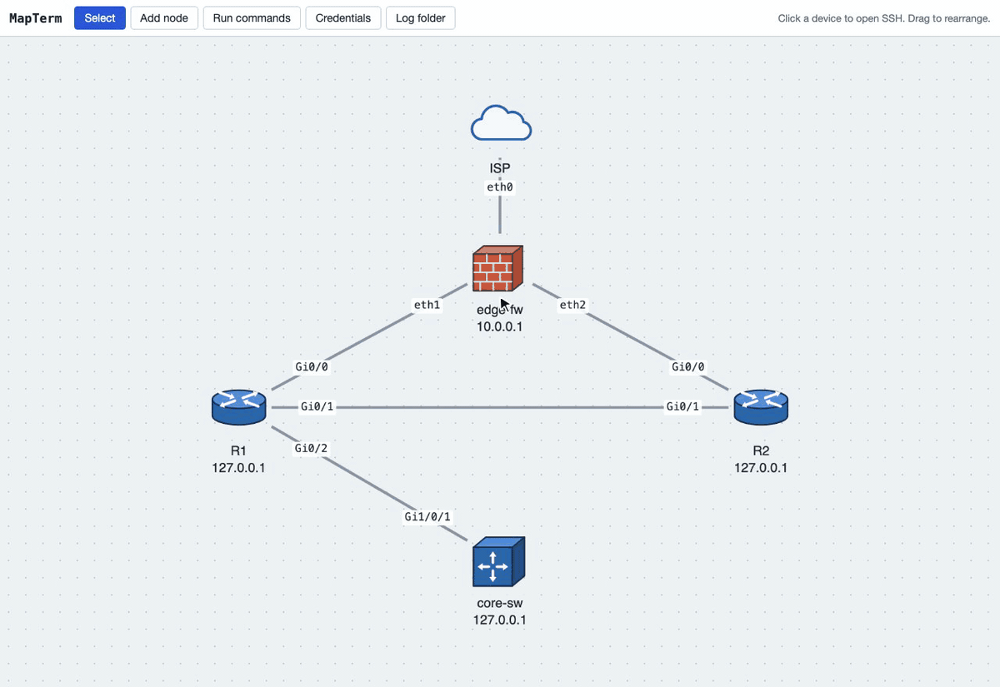

# MapTerm

A network topology map you work from. Draw your devices and links, then click a device to
open an SSH or Telnet terminal, record sessions, and run commands across many devices with a safety
check for configuration changes.



*In the demo: save a credential set (its passwords go to the macOS Keychain) and give it to R1;
draw a link with interface names; open SSH to R1, which logs in and enters enable mode by itself,
and record the session; then run a change on three devices. MapTerm asks for confirmation, tests
on R1 first, and continues on the rest when told to.*

## Features

- **Topology maps**: routers, switches, firewalls, servers and more, with links labelled by
  interface (`Gi0/1`, `eth0`). Parallel links between the same devices are supported.
- **Several maps**: keep separate maps for production, lab or a planned build, and switch
  between them from the toolbar. Duplicate a map to plan a change, or export it to a file to
  share or back it up (exports never contain passwords).
- **SSH and Telnet terminals**: click a device to open a session in a dock of tabs, one per
  device. Drag tabs to reorder them. Older devices that only offer legacy SSH algorithms work
  too, and Telnet is there for gear without SSH (marked "· telnet" on the map, since it is not
  encrypted). Over Telnet, MapTerm answers the device's login prompts from the credential set;
  devices without one (such as console-server ports) connect without a login, and MapTerm
  presses Enter for lines that stay silent until a key is pressed.
- **Credential sets**: usernames with passwords or SSH keys, plus an optional enable password.
  Passwords are kept in the operating system's secure store, never in MapTerm's files. With
  an enable password, MapTerm enters enable mode automatically at a `>` prompt.
- **Session recording**: record a tab (`Ctrl+Shift+L`) to a clean text log, without colour
  codes, pagers or typos you corrected. Each map has its own log folder, chosen the first
  time you record on it.
- **Run commands**: run a list of commands on several devices in parallel and save the
  output, one file per device or one file per command, into the map's own results folder.
  Commands that may change a device need a typed confirmation and can be tested on one
  device first.

## Desktop app

Download the installer for your system from the project's **Releases** page:

| OS | File |
|---|---|
| macOS (Apple Silicon / Intel) | `MapTerm-<version>-arm64.dmg` / `MapTerm-<version>.dmg` |
| Windows | `MapTerm Setup <version>.exe` |
| Linux | `MapTerm-<version>.AppImage` (make it executable, then run it) |

The installers are not yet signed with Apple or Microsoft certificates, so the first launch
shows a warning:

- **macOS:** open the app once, then go to *System Settings → Privacy & Security* and choose
  **Open Anyway** (on older macOS: right-click the app and choose **Open**).
- **Windows:** in the SmartScreen message, choose **More info → Run anyway**.

The app keeps its data in the same folder as `npm start` (see [Where data is kept](#where-data-is-kept)),
so both share the same map and settings.

## Running from source

Requires [Node.js](https://nodejs.org) 18 or newer, on macOS, Windows or Linux.

On a Linux desktop, install `zenity` (or use KDE's `kdialog`) for the folder chooser, and
`libsecret-tools` to keep passwords in the system keyring. Without them MapTerm still works:
you type folder paths, and passwords are kept until MapTerm stops.

```bash
npm install
npm start          # in your browser at http://127.0.0.1:3000
npm run app        # or as the desktop app
```

Choose **Add node** and click the map to place a device.

| Setting | Default | Purpose |
|---|---|---|
| `PORT` | `3000` | Port to listen on |
| `BIND` | `127.0.0.1` | Address to listen on (see [Security](#security)) |
| `MAPTERM_DATA_DIR` | see below | Where MapTerm keeps its data |

## Where data is kept

MapTerm keeps your map and settings in a per-user folder, separate from the code:

| OS | Folder |
|---|---|
| macOS | `~/Library/Application Support/MapTerm` |
| Windows | `%APPDATA%\MapTerm` |
| Linux | `~/.config/mapterm` |

It contains `maps/` (one `.json` file per map: devices, links, and the map's log and results
folders), `settings.json` (credential set names, the map last opened) and, on Windows,
`secrets.dpapi.json` (encrypted passwords). Credential sets are shared by all maps.
Passwords themselves are stored by the operating system:

| OS | Password store |
|---|---|
| macOS | Keychain (entries named "MapTerm: <set name>") |
| Windows | Encrypted with DPAPI for your Windows account |
| Linux | Secret Service keyring (GNOME Keyring, KWallet) via `secret-tool` |

Session recordings and command results go to folders you choose per map in the app.

## Security

MapTerm handles device passwords, so by default it only accepts connections from this
computer (`127.0.0.1`), and its API and terminal connections refuse requests from other
websites. Telnet sends passwords and everything else unencrypted over the network; use it only
where SSH is not available, ideally on a management network. Only set `BIND` to another address on a network you trust: MapTerm has no login
of its own, so anyone who can reach it can use your saved credentials.

## Development

```bash
npm run dev            # restart automatically when server files change
npm test               # unit and API tests (Node's built-in test runner)
npm run devices:up     # start the test devices (needs Docker)
npm run devices:down   # stop them
npm run dist:mac       # build installers into dist/ (also dist:win, dist:linux)
```

To release, push a version tag (`git tag v1.0.0 && git push --tags`). The
[Build installers](.github/workflows/release.yml) workflow then builds the macOS, Windows
and Linux installers on GitHub and attaches them to a draft release for you to publish.

The test devices in [dev/test-devices](dev/test-devices) are SSH containers on
`127.0.0.1`. Ports 2221–2223 are Linux shells; `R1` imitates a Cisco IOS command line with
an enable password, configuration modes and a `--More--` pager, over SSH (port 2224) and
Telnet (port 2323). Log in with `admin` / `admin`; the enable password is `cisco`.

### Project layout

```
electron/main.js     desktop app: runs the server and shows the page in a window
build/               app icon (icon.svg is the source of icon.png)
src/
  server/            Node.js server
    index.js         entry point (npm start)
    app.js           HTTP server: page, API, /ssh WebSocket
    config.js        port, data folder, settings
    api.js           settings and folder routes
    maps.js          maps: one file per map, create/duplicate/import
    terminal.js      terminal tabs and recording over the /ssh WebSocket
    shell.js         one interface for SSH and Telnet sessions
    telnet.js        Telnet client (option negotiation)
    batch.js         "Run commands" across devices
    cli.js           prompts, pagers, Telnet login and enable mode
    credentials.js   credential sets
    vault.js         OS password stores
    session-log.js   turns terminal output into clean text
    platform.js      native folder chooser, "show in file manager"
    files.js         file name and path helpers
  web/               the page (plain ES modules, no build step)
    index.html
    css/app.css
    js/main.js       starts the modules below
    js/map.js        the map, modes, device menu
    js/maps.js       switching maps; new, duplicate, rename, export, import
    js/links.js      drawing links, interface names
    js/sessions.js   terminal tabs and the dock
    js/recording.js  session recording
    js/run.js        "Run commands" and the progress panel
    js/commands.js   read-only / change / disruptive classification
    js/credentials.js, settings.js, dialog.js, icons.js, dom.js
test/                tests (npm test)
dev/test-devices/    Docker test devices
docs/                demo GIF for this README
```

## License

Copyright (C) 2026 Siddharth Kumar Tirkey

MapTerm is free software: you can redistribute it and/or modify it under the terms of the
[GNU Affero General Public License, version 3](LICENSE) (AGPL-3.0-only), as published by
the Free Software Foundation. It is distributed in the hope that it will be useful, but
WITHOUT ANY WARRANTY; see the license for details.

In short: you can use MapTerm freely, including at work. If you give a modified version to
others, or let others use a modified version over a network, you must make your modified
source code available to them under the same license.
