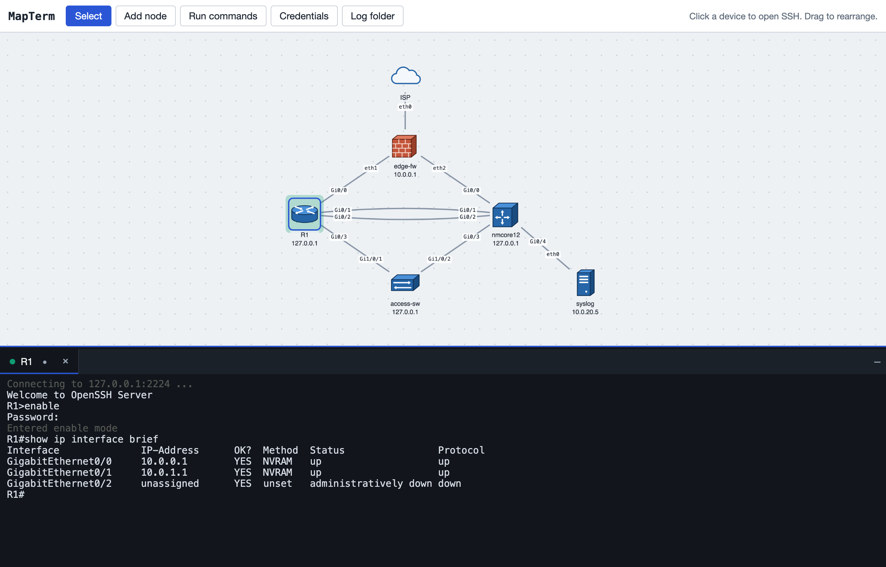

# MapTerm

A network topology map you work from. Draw your devices and links, then click a device to
open an SSH terminal, record sessions, and run commands across many devices with a safety
check for configuration changes.



## Features

- **Topology map**: routers, switches, firewalls, servers and more, with links labelled by
  interface (`Gi0/1`, `eth0`). Parallel links between the same devices are supported.
- **SSH terminals**: click a device to open a session in a dock of tabs, one per device.
  Drag tabs to reorder them. Older devices that only offer legacy SSH algorithms work too.
- **Credential sets**: usernames with passwords or SSH keys, plus an optional enable password.
  Passwords are kept in the operating system's secure store, never in MapTerm's files. With
  an enable password, MapTerm enters enable mode automatically at a `>` prompt.
- **Session recording**: record a tab (`Ctrl+Shift+L`) to a clean text log, without colour
  codes, pagers or typos you corrected.
- **Run commands**: run a list of commands on several devices in parallel and save the output,
  one file per device or one file per command. Commands that may change a device need a typed
  confirmation and can be tested on one device first.

## Requirements

- [Node.js](https://nodejs.org) 18 or newer
- macOS, Windows or Linux

On a Linux desktop, install `zenity` (or use KDE's `kdialog`) for the folder chooser, and
`libsecret-tools` to keep passwords in the system keyring. Without them MapTerm still works:
you type folder paths, and passwords are kept until MapTerm stops.

## Getting started

```bash
npm install
npm start
```

Open <http://127.0.0.1:3000>, choose **Add node** and click the map to place a device.

| Setting | Default | Purpose |
|---|---|---|
| `PORT` | `3000` | Port to listen on |
| `BIND` | `127.0.0.1` | Address to listen on (see [Security](#security)) |
| `MAPTERM_DATA_DIR` | see below | Where MapTerm keeps its data |

## Where data is kept

MapTerm keeps your map and settings in a per-user folder, separate from the code:

| OS | Folder |
|---|---|
| macOS | `~/Library/Application Support/MapTerm` |
| Windows | `%APPDATA%\MapTerm` |
| Linux | `~/.config/mapterm` |

It contains `topology.json` (devices and links), `settings.json` (log and results folders,
credential set names) and, on Windows, `secrets.dpapi.json` (encrypted passwords).
Passwords themselves are stored by the operating system:

| OS | Password store |
|---|---|
| macOS | Keychain (entries named "MapTerm: <set name>") |
| Windows | Encrypted with DPAPI for your Windows account |
| Linux | Secret Service keyring (GNOME Keyring, KWallet) via `secret-tool` |

Session logs and command results go to folders you choose in the app.

## Security

MapTerm handles device passwords, so by default it only accepts connections from this
computer (`127.0.0.1`), and its API and terminal connections refuse requests from other
websites. Only set `BIND` to another address on a network you trust: MapTerm has no login
of its own, so anyone who can reach it can use your saved credentials.

## Development

```bash
npm run dev            # restart automatically when server files change
npm test               # unit and API tests (Node's built-in test runner)
npm run devices:up     # start the test devices (needs Docker)
npm run devices:down   # stop them
```

The test devices in [dev/test-devices](dev/test-devices) are SSH containers on
`127.0.0.1`. Ports 2221–2223 are Linux shells; port 2224 (`R1`) imitates a Cisco IOS
command line with an enable password, configuration modes and a `--More--` pager. Log in
with `admin` / `admin`; the enable password is `cisco`.

### Project layout

```
src/
  server/            Node.js server
    index.js         entry point (npm start)
    app.js           HTTP server: page, API, /ssh WebSocket
    config.js        port, data folder, settings
    api.js           topology, settings and folder routes
    terminal.js      SSH tabs and recording over the /ssh WebSocket
    batch.js         "Run commands" across devices
    cli.js           prompts, pagers and enable mode
    credentials.js   credential sets
    vault.js         OS password stores
    session-log.js   turns terminal output into clean text
    platform.js      native folder chooser, "show in file manager"
    files.js         file name and path helpers
  web/               the page (plain ES modules, no build step)
    index.html
    css/app.css
    js/main.js       starts the modules below
    js/map.js        the map, modes, device menu
    js/links.js      drawing links, interface names
    js/sessions.js   terminal tabs and the dock
    js/recording.js  session recording
    js/run.js        "Run commands" and the progress panel
    js/commands.js   read-only / change / disruptive classification
    js/credentials.js, settings.js, dialog.js, icons.js, dom.js
test/                tests (npm test)
dev/test-devices/    Docker test devices
docs/                screenshot
```
